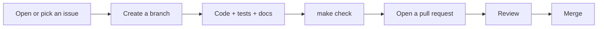

# Contributing

Thank you for helping! This guide explains how to propose changes and how
releases are made.

<!-- TOC -->
- [Code of conduct](#code-of-conduct)
- [Getting started](#getting-started)
- [Making a change](#making-a-change)
- [Coding guidelines](#coding-guidelines)
  - [Go](#go)
  - [Tests](#tests)
  - [Web UI](#web-ui)
  - [Helm chart](#helm-chart)
  - [Documentation](#documentation)
- [Commit messages](#commit-messages)
- [Pull request checklist](#pull-request-checklist)
- [Releasing](#releasing)
- [Reporting security issues](#reporting-security-issues)
<!-- TOC -->

## Code of conduct

Be respectful and constructive. Assume good intent and focus on the code.

## Getting started

```bash
git clone https://github.com/aeciopires/docker-hub-image-statistics.git
cd docker-hub-image-statistics
make install-deps     # REQUIREMENTS.md explains every tool
make check-deps
make test
```

## Making a change



1. Create a branch from `main`: `git switch -c feat/short-description`.
2. Keep changes focused; one topic per pull request.
3. Add or update tests and documentation in the same pull request.
4. Add an entry under `## [Unreleased]` in [CHANGELOG.md](CHANGELOG.md).

## Coding guidelines

### Go

- Target the Go version in [`go.mod`](go.mod) and follow the
  [Modern Go Guidelines](https://github.com/JetBrains/go-modern-guidelines)
  (for example `encoding/json/v2` for new JSON code, `wg.Go`, `t.Context()`,
  `errors.AsType`, `cmp.Or`, range-over-int, method-aware `ServeMux` patterns).
- `make fmt` and `make lint` must pass (configuration in
  [`.golangci.yml`](.golangci.yml)).
- Pass `context.Context` as the first parameter of anything that does I/O.
- Wrap errors with `%w` and context (`fmt.Errorf("save snapshots: %w", err)`).
- Log with `slog` and key/value pairs; never log secrets.
- Keep packages under `internal/`; avoid new dependencies unless they clearly pay
  off (the image must stay static: no CGO).

### Tests

- `make coverage` enforces **at least 90%** total coverage.
- Prefer table-driven tests, `httptest` servers and injected clocks over sleeps.
- Run `make test-race` for concurrent code.

### Web UI

- Plain HTML/CSS/JS in `internal/web/static`; no external resources at runtime.
- Use the Material Design 3 tokens in `app.css`; check both themes (dark is the default).
- Render data with `textContent`, never `innerHTML`.

### Helm chart

- Helm 4 only. Document every value with a `# --` comment and run `make helm-docs`.
- `make helm-validate` must pass (lint, kubeconform, trivy).
- Keep the restricted security defaults.

### Documentation

- Every Markdown file starts with a table of contents (TOC).
- Validate diagrams with `make docs-validate`.
- Write for beginners: explain the *why*, use analogies and diagrams.

## Commit messages

Use [Conventional Commits](https://www.conventionalcommits.org/):

```text
feat(collector): support include globs
fix(store): keep partial results when a namespace fails
docs: explain cache tiers
```

`feat` maps to a MINOR release, `fix` to a PATCH release and `BREAKING CHANGE:`
to a MAJOR release.

## Pull request checklist

- [ ] `make check` passes (format, vet, lint, coverage ≥ 90%, govulncheck,
      version check, hadolint, Helm validation)
- [ ] `make docker-build docker-scan` passes when the image changes
- [ ] `make docs-validate` passes when diagrams change
- [ ] Documentation and `CHANGELOG.md` updated

## Releasing

The [`VERSION`](VERSION) file is the single source of truth (Semantic Versioning).

1. Update `VERSION` (for example `1.1.0`).
2. Move the `Unreleased` entries of [CHANGELOG.md](CHANGELOG.md) to a new
   `## [1.1.0] - YYYY-MM-DD` section and update the comparison links.
3. `make version-sync` (updates `Chart.yaml` `version`/`appVersion` and the chart README).
4. `make check docker-build docker-scan`.
5. Commit, tag and push: `git tag v1.1.0 && git push --tags`.
6. `make docker-push` (multi-arch, tags `1.1.0` and `latest`) and `make helm-package`.

## Reporting security issues

Do not open a public issue for vulnerabilities. Contact the maintainer through
the e-mail on the GitHub profile, with steps to reproduce.
