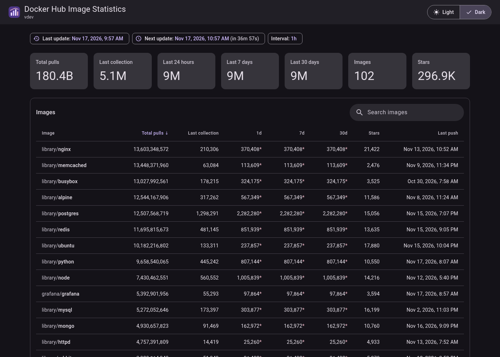
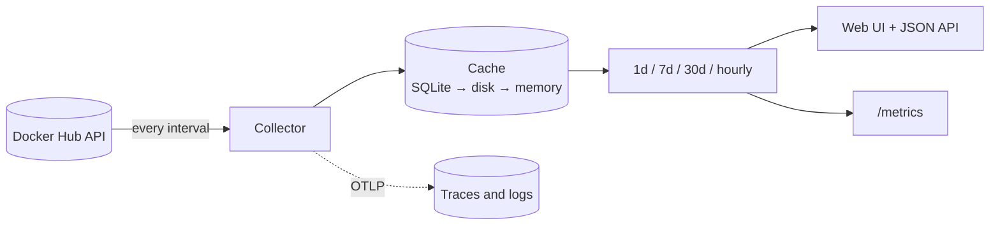
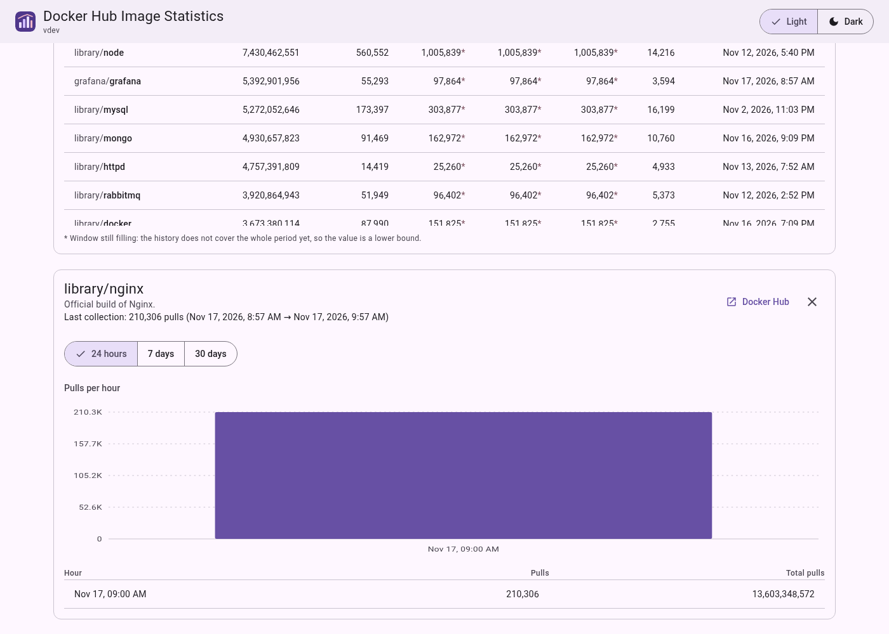
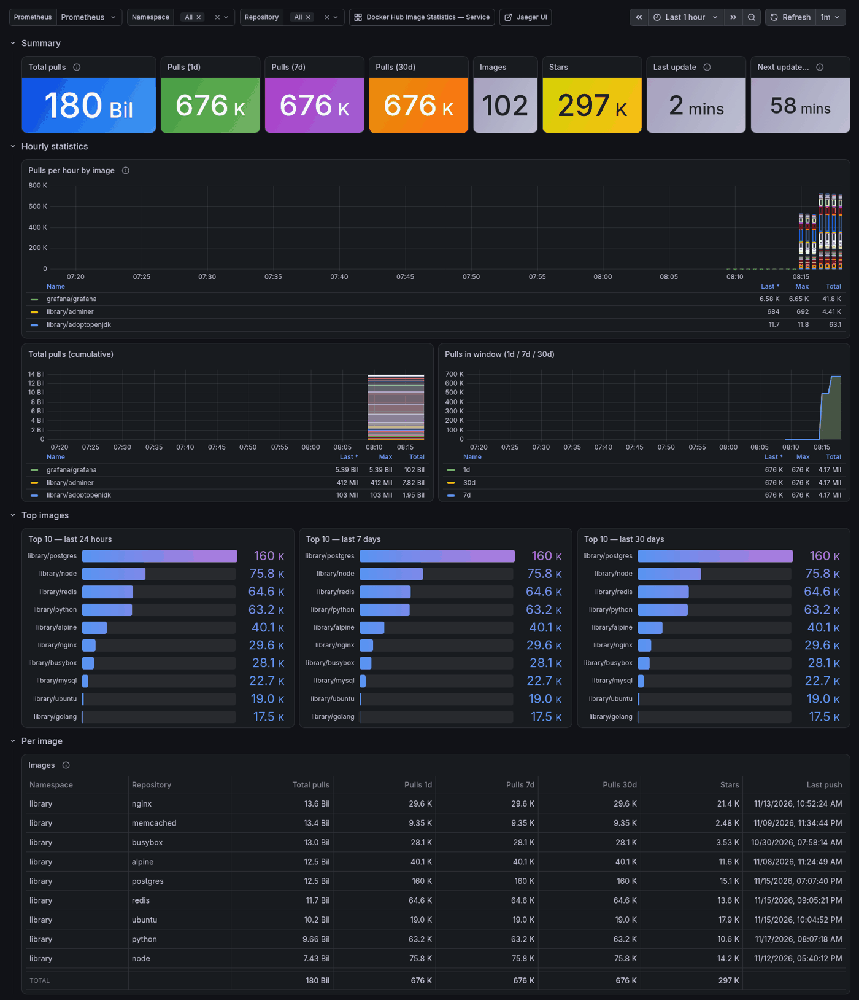

# docker-hub-image-statistics

A tool to display statistics about Docker images published on Docker Hub: total
pulls, pulls in the last 1, 7 and 30 days and hour by hour, for every public
image of a user or organization — with a web UI, a JSON API, Prometheus metrics,
OpenTelemetry traces and JSON logs.



<!-- TOC -->
- [docker-hub-image-statistics](#docker-hub-image-statistics)
  - [Features](#features)
  - [Quick start](#quick-start)
    - [Docker](#docker)
    - [Docker Compose with the observability stack](#docker-compose-with-the-observability-stack)
    - [Kubernetes (Helm 4)](#kubernetes-helm-4)
    - [From source](#from-source)
  - [Configuration](#configuration)
  - [How it works](#how-it-works)
  - [Endpoints](#endpoints)
  - [Screenshots](#screenshots)
  - [Documentation](#documentation)
  - [Development](#development)
  - [References](#references)
  - [Developer](#developer)
  - [License](#license)
<!-- TOC -->

## Features

- **Discovery** of every public image of the configured users/organizations,
  plus explicit images, with include/exclude globs.
- **Pull statistics**: total, last 24 hours, 7 days and 30 days per image and in
  total, plus an **hourly** series (chart + table).
- **Pulls in the last collection** (between the two newest snapshots) per image
  and in total, in the UI, API, metrics and Grafana.
- **Configurable schedule** (default every hour) with *last update* and *next
  update* shown in the UI, API and metrics; restarts keep the schedule.
- **Configuration reload** with `SIGHUP` (`make reload`, `make compose-reload`;
  `make helm-reload` on Kubernetes); invalid files are rejected.
- **Respects Docker Hub rate limits**: client-side pacing, quota headers,
  `Retry-After`, minimum interval for anonymous use.
- **Three cache tiers** — SQLite, disk (JSON) and memory, in this order — with
  automatic fallback and warm-up.
- **Web UI** following Material Design 3, **dark mode by default** with a
  light/dark selector; fully self-contained (fonts, icons, favicon embedded).
- **Observability**: Prometheus metrics, OpenTelemetry traces, JSON logs with
  level (default `INFO`) and trace correlation; Grafana dashboards included.
- **Health checks**: `/healthz` and `/readyz`, plus a `healthcheck` command for
  shell-less containers.
- **Configuration** through YAML, environment variables, or defaults.
- **Secure image**: distroless, non-root, read-only friendly, ~26 MB, scanned
  with trivy; multi-arch (`amd64`, `arm64`).
- **Helm 4 chart** with probes, NetworkPolicy, restricted Pod Security,
  Ingress, Gateway API `HTTPRoute`, `extraObjects`, ServiceMonitor and dashboards.

## Quick start

### Docker

```bash
docker run -d --name dhis -p 8080:8080 \
  --read-only --cap-drop ALL --security-opt no-new-privileges \
  -v dhis-data:/data \
  -e DHIS_DOCKERHUB_NAMESPACES=library \
  -e DHIS_DOCKERHUB_REPOSITORIES=grafana/grafana,prom/prometheus \
  aeciopires/docker-hub-image-statistics:latest
```

Open <http://localhost:8080>.

### Docker Compose with the observability stack

```bash
make stack-up     # app + OTel Collector, Prometheus, Loki, Tempo, Jaeger, Grafana
```

| Service | URL |
| --- | --- |
| Application | <http://localhost:8080> |
| Grafana | <http://localhost:3000> |
| Prometheus | <http://localhost:9090> |
| Jaeger | <http://localhost:16686> |

`make up` starts only the application; `make stack-down` stops everything.

### Kubernetes (Helm 4)

```bash
helm upgrade --install dhis charts/docker-hub-image-statistics \
  -n dhis --create-namespace --set 'config.dockerhub.namespaces={myorg}'
```

See the [chart README](charts/docker-hub-image-statistics/README.md).

### From source

```bash
make install-deps          # see REQUIREMENTS.md
cp config.example.yaml config.yaml
make run
```

Command line (POSIX flags, `-h` on every command):

```bash
docker-hub-image-statistics -h                         # help
docker-hub-image-statistics -v                         # version
docker-hub-image-statistics -c config.yaml             # serve with a file
docker-hub-image-statistics -n myorg -r nginx -i 30m   # flags only
docker-hub-image-statistics config -c config.yaml      # print the effective configuration
```

## Configuration

Defaults → `config.yaml` → `DHIS_*` environment variables → command-line flags
(Viper + Cobra). The most common settings:

| Setting | Variable | Default |
| --- | --- | --- |
| `dockerhub.namespaces` | `DHIS_DOCKERHUB_NAMESPACES` | `library` |
| `dockerhub.repositories` | `DHIS_DOCKERHUB_REPOSITORIES` | empty |
| `collector.interval` | `DHIS_COLLECTOR_INTERVAL` | `1h` |
| `log.level` | `DHIS_LOG_LEVEL` | `info` |
| `dockerhub.username` / `token` | `DHIS_DOCKERHUB_USERNAME` / `DHIS_DOCKERHUB_TOKEN` | anonymous |

Anonymous clients are limited by Docker Hub to 180 API calls per minute per IP
and to the first 100 repositories of a namespace; a read-only personal access
token lifts both. Full reference: [docs/configuration.md](docs/configuration.md).

## How it works

Docker Hub only reports the **cumulative** pull counter of each image. The
application stores a snapshot of it at every collection and derives the pulls
of each period from the difference between snapshots — like reading a water
meter every hour.



The 1d/7d/30d values become complete once the application has been running
for that long; until then they are lower bounds, marked with `*`.
Details: [docs/architecture.md](docs/architecture.md).

## Endpoints

| Path | Description |
| --- | --- |
| `/` | Web UI |
| `/api/v1/images`, `/api/v1/images/{ns}/{name}`, `.../history` | JSON API ([docs/api.md](docs/api.md)) |
| `/api/v1/summary`, `/api/v1/status`, `/api/v1/version` | Totals, collector status, build info |
| `/metrics` | Prometheus metrics |
| `/healthz`, `/readyz` | Liveness and readiness |

## Screenshots

| Light mode | Grafana: image statistics |
| --- | --- |
|  |  |

Grafana service dashboard (metrics, traces and logs):
[docs/images/grafana-service.png](docs/images/grafana-service.png).

## Documentation

| Document | Content |
| --- | --- |
| [docs/README.md](docs/README.md) | Documentation index |
| [docs/architecture.md](docs/architecture.md) | Components and data flow |
| [docs/features.md](docs/features.md) | How each feature works |
| [docs/configuration.md](docs/configuration.md) | All options |
| [docs/api.md](docs/api.md) | HTTP API |
| [docs/observability.md](docs/observability.md) | Metrics, logs, traces, dashboards |
| [docs/deployment.md](docs/deployment.md) | Binary, Docker, Compose, Helm |
| [docs/development.md](docs/development.md) | Code tour for new contributors |
| [REQUIREMENTS.md](REQUIREMENTS.md) | Tools and installation |
| [CONTRIBUTING.md](CONTRIBUTING.md) | How to contribute and release |
| [CHANGELOG.md](CHANGELOG.md) | Release history |

## Development

```bash
make help          # every target
make test          # unit tests
make coverage      # tests + 90% coverage gate
make check         # every quality gate
make run           # run locally; "make reload" applies config.yaml changes
make kind-up       # local Kubernetes: kind cluster + image + Helm chart
```

## References

- [oilbeater/hubinsight](https://github.com/oilbeater/hubinsight): tracking
  Docker Hub pull counts over time.
- [Docker image statistics from hub.docker.com (Stack Overflow)](https://stackoverflow.com/questions/53176436/docker-image-statistics-from-hub-docker-com).
- [Docker Hub API](https://docs.docker.com/reference/api/hub/latest/) and
  [usage and rate limits](https://docs.docker.com/docker-hub/usage/).
- [Material Design 3](https://m3.material.io/).

## Developer

- Aecio Pires - [https://linktree/aeciopires](https://linktr.ee/aeciopires)

## License

[GPL-3.0](LICENSE). The embedded Roboto font is licensed under the
[SIL Open Font License 1.1](internal/web/static/fonts/LICENSE-Roboto-OFL.txt).
