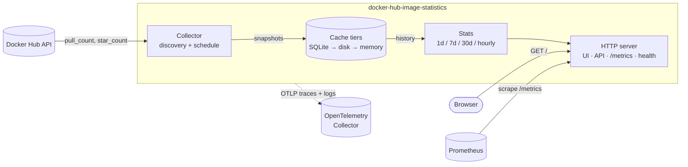
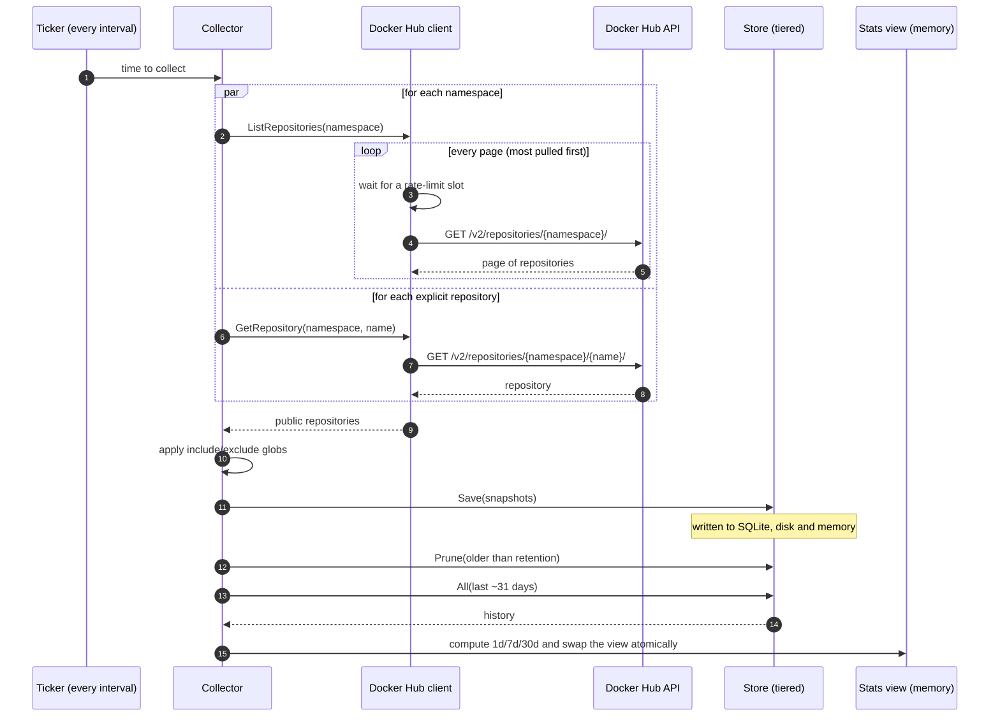
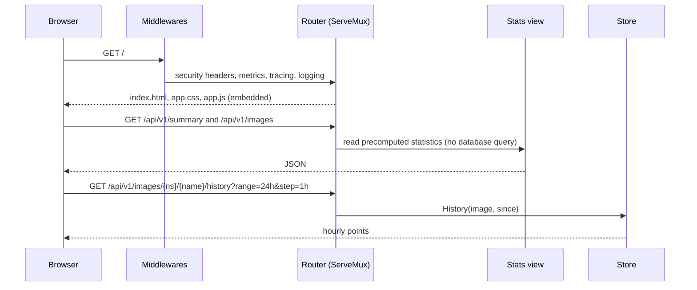
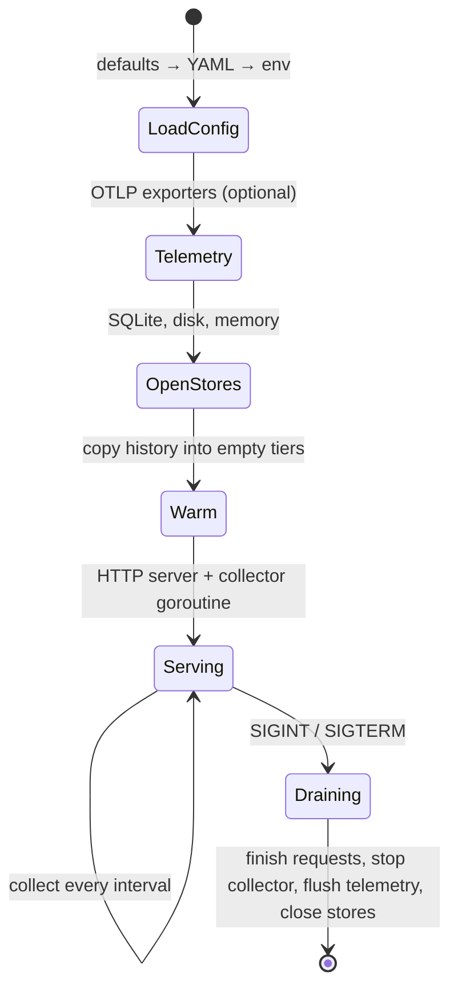

# Architecture

How the pieces of Docker Hub Image Statistics fit together, explained for
someone who is new to Go and to backend services.

<!-- TOC -->
- [The big picture](#the-big-picture)
- [An analogy: the neighborhood water meter reader](#an-analogy-the-neighborhood-water-meter-reader)
- [Components](#components)
- [What happens in one collection cycle](#what-happens-in-one-collection-cycle)
- [What happens when you open the web page](#what-happens-when-you-open-the-web-page)
- [Package layout](#package-layout)
- [Startup and shutdown](#startup-and-shutdown)
- [Design decisions](#design-decisions)
<!-- TOC -->

## The big picture

The application is a single Go binary that does three jobs at the same time:

1. **Collects**: every hour (configurable) it asks the Docker Hub API how many
   times each image was pulled and stores the answer (a *snapshot*).
2. **Computes**: it compares snapshots to find out how many pulls happened in
   the last hour, day, 7 days and 30 days.
3. **Serves**: it exposes the results through a web UI, a JSON API and
   Prometheus metrics, and sends traces and logs to OpenTelemetry.



## An analogy: the neighborhood water meter reader

Docker Hub only tells us the **total** number of pulls an image ever had, just
like a water meter only shows the total liters ever consumed. To know how much
water a house used *yesterday*, the utility company sends a reader who writes
down the meter value every day and subtracts:

| Water company | This application |
| --- | --- |
| The route of houses to visit | **Discovery**: the namespaces and repositories in the configuration |
| Reading the meter | Calling the Docker Hub API (`pull_count`) |
| The notebook with every reading | The **snapshots** in the cache (SQLite, disk, memory) |
| "Used yesterday" = today's reading − yesterday's reading | **Window pulls** (1d, 7d, 30d) |
| Readings every hour on a chart | **Hourly statistics** |
| Not knocking too often on the same door | **Rate limiting** (Docker Hub allows 180 requests/min per IP) |

That is why the 1d/7d/30d values only become *complete* after the application
has been running for that long: before that, there is no old reading to
subtract from. The UI marks those values with `*` and the API returns
`"complete": false`.

## Components

| Component | Package | Responsibility |
| --- | --- | --- |
| Configuration | `internal/config` | Defaults → YAML file → `DHIS_*` environment variables, plus validation |
| Docker Hub client | `internal/dockerhub` | Pagination, retries with back-off, rate limiting, optional authentication |
| Collector | `internal/collector` | Discovery, include/exclude filters, scheduling, status (last/next update) |
| Statistics | `internal/stats` | Window pulls (1d/7d/30d), hourly series, summaries |
| Store | `internal/store` | Cache tiers: SQLite, JSON file on disk, memory, and the `Tiered` combination |
| Metrics | `internal/metrics` | Prometheus registry and per-image metrics |
| Telemetry | `internal/telemetry` | OpenTelemetry traces and logs exported over OTLP/HTTP |
| Logging | `internal/logging` | JSON logs with level (default `INFO`) and `trace_id`/`span_id` |
| HTTP server | `internal/server` | Web UI, JSON API, `/healthz`, `/readyz`, `/metrics`, security headers |
| Web UI | `internal/web` | Embedded HTML/CSS/JS, fonts and favicon (no Internet access needed) |
| Application | `internal/app` | Wires everything, CLI commands, graceful shutdown |

## What happens in one collection cycle



A failure in one namespace does not throw away the others: partial results are
saved and the error is shown in the UI and in `/api/v1/status`.

## What happens when you open the web page



The summary and the table are served from memory (an `atomic.Pointer` swapped
after every collection), so the page stays fast no matter how many snapshots
exist. Only the detail chart reads the store.

## Package layout

```text
cmd/docker-hub-image-statistics/   main.go: signal handling and exit code
internal/
  app/          wiring, CLI (serve | healthcheck | version)
  collector/    discovery, schedule, status
  config/       defaults, YAML, environment variables
  dockerhub/    Docker Hub API client
  logging/      slog JSON handler with trace correlation
  metrics/      Prometheus metrics
  server/       HTTP handlers and middlewares
  stats/        window and hourly computations
  store/        SQLite, disk, memory and tiered stores
  telemetry/    OpenTelemetry setup
  version/      build metadata (set by -ldflags)
  web/static/   UI assets embedded with go:embed
charts/         Helm chart (Helm 4) and Grafana dashboards
deploy/compose/ docker compose files and observability configuration
scripts/        dependency checks, version sync, diagram validation
```

`internal/` is a Go convention: those packages cannot be imported by other
modules, which keeps the public surface of the project small.

## Startup and shutdown



The process listens for `SIGTERM` (sent by Docker and Kubernetes) and shuts
down gracefully within `server.shutdown_timeout`.

## Design decisions

- **Pure-Go SQLite** (`modernc.org/sqlite`): no C compiler is needed, so the
  binary is static and runs on a *distroless* image.
- **Snapshots instead of counters**: Docker Hub exposes only totals, so the
  history is the source of truth; every derived number can be recomputed.
- **Cache order SQLite → disk → memory**: writes go to every tier; reads use the
  first tier that answers. If SQLite breaks, the JSON file keeps working; if the
  disk is read-only, memory still serves the current run. See
  [features.md](features.md#cache-tiers).
- **Rate limiting on the client**: Docker Hub allows 180 requests per minute per
  IP for anonymous clients. The client paces itself (60/min by default) and
  pauses when the `X-RateLimit-Remaining` header gets low.
- **Self-contained UI**: fonts, icons and favicon are embedded so the app works
  in air-gapped networks and the Content-Security-Policy can forbid any
  external origin.
