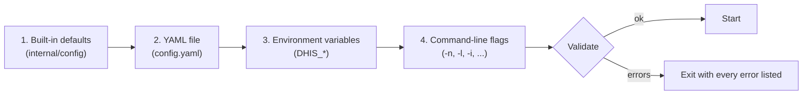
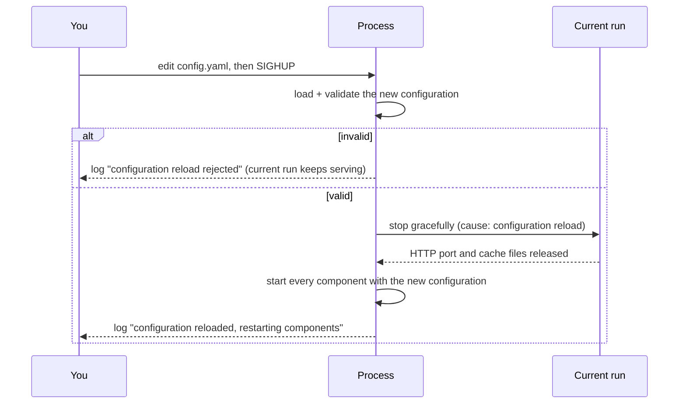

# Configuration

<!-- TOC -->
- [Where settings come from](#where-settings-come-from)
- [Choosing the configuration file](#choosing-the-configuration-file)
- [Command line](#command-line)
  - [Commands](#commands)
  - [Flags](#flags)
  - [Checking the effective configuration](#checking-the-effective-configuration)
- [Reference](#reference)
  - [server](#server)
  - [log](#log)
  - [dockerhub](#dockerhub)
  - [collector](#collector)
  - [cache](#cache)
  - [telemetry](#telemetry)
- [Value formats](#value-formats)
- [Validation](#validation)
- [Reloading the configuration](#reloading-the-configuration)
  - [Local process](#local-process)
  - [Docker Compose](#docker-compose)
  - [Kubernetes (kind + Helm)](#kubernetes-kind--helm)
<!-- TOC -->

## Where settings come from

Settings are applied in layers; each layer overrides the previous one, like
stickers placed on top of each other. The layers are merged by
[Viper](https://github.com/spf13/viper) and the command line is parsed by
[Cobra](https://github.com/spf13/cobra):



The application works with **no file, no variables and no flags**: it tracks
the official images (`library`) every hour. Every YAML key has an environment
variable named `DHIS_` + the key in upper case with `.` replaced by `_`
(`cache.sqlite.path` → `DHIS_CACHE_SQLITE_PATH`).

## Choosing the configuration file

1. `-c` / `--config <path>` flag (`docker-hub-image-statistics -c my.yaml`);
2. otherwise `DHIS_CONFIG_FILE`;
3. otherwise `./config.yaml` when it exists.

When a file is given explicitly (1 or 2) and does not exist, startup fails.
Unknown keys are rejected to catch typos. Start from
[`config.example.yaml`](../config.example.yaml).

## Command line

POSIX-style flags: short (`-c file`) and long (`--config file` or
`--config=file`). `-h`/`--help` works on every command.

### Commands

| Command | Description |
| --- | --- |
| *(none)* / `serve` | Run the collector, the API and the web UI |
| `config` | Validate and print the effective configuration (secrets redacted) |
| `healthcheck [-u URL] [-t TIMEOUT]` | Probe a running instance; exit 0 when healthy |
| `version [-s]` | Print the version (`-s`: number only) |
| `completion bash\|zsh\|fish\|powershell` | Generate shell autocompletion |
| `help [command]` | Show help |

Global: `-h`, `--help` (help) and `-v`, `--version` (version).
Exit codes: `0` success, `1` runtime or configuration error, `2` usage error
(unknown command or flag).

### Flags

Accepted by `serve` (and the root command) and by `config`. They override the
environment and the file, and keep their precedence across reloads.

| Short | Long | Configuration key |
| --- | --- | --- |
| `-c` | `--config` | configuration file (not a key) |
| `-a` | `--address` | `server.address` |
| `-l` | `--log-level` | `log.level` |
| | `--log-format` | `log.format` |
| `-n` | `--namespaces` | `dockerhub.namespaces` (comma separated, repeatable) |
| `-r` | `--repositories` | `dockerhub.repositories` (comma separated, repeatable) |
| `-i` | `--interval` | `collector.interval` (`30m`, `1h`, `1d`) |
| | `--otlp-endpoint` | `telemetry.otlp_endpoint` |
| | `--traces` | `telemetry.traces` |
| | `--otlp-logs` | `telemetry.logs` |

Every other setting is available through the YAML file or `DHIS_*` variables.

```bash
docker-hub-image-statistics -n myorg,otherorg -r nginx -i 30m -l debug
docker-hub-image-statistics serve --config /etc/dhis/config.yaml --address :9000
```

### Checking the effective configuration

`config` loads everything exactly like `serve` and prints the merged result,
which is handy to debug precedence or a reload:

```bash
$ DHIS_LOG_LEVEL=warn docker-hub-image-statistics config -c config.yaml -l debug
# configuration file: config.yaml
server:
  address: :8080
  ...
log:
  level: debug        # the flag wins over DHIS_LOG_LEVEL and the file
```

## Reference

### server

| YAML key | Environment variable | Default | Description |
| --- | --- | --- | --- |
| `server.address` | `DHIS_SERVER_ADDRESS` | `:8080` | Listen address |
| `server.read_timeout` | `DHIS_SERVER_READ_TIMEOUT` | `10s` | Maximum time to read a request |
| `server.write_timeout` | `DHIS_SERVER_WRITE_TIMEOUT` | `30s` | Maximum time to write a response |
| `server.idle_timeout` | `DHIS_SERVER_IDLE_TIMEOUT` | `120s` | Keep-alive idle timeout |
| `server.shutdown_timeout` | `DHIS_SERVER_SHUTDOWN_TIMEOUT` | `15s` | Graceful shutdown deadline |

### log

| YAML key | Environment variable | Default | Description |
| --- | --- | --- | --- |
| `log.level` | `DHIS_LOG_LEVEL` | `info` | `debug`, `info`, `warn` or `error` |
| `log.format` | `DHIS_LOG_FORMAT` | `json` | `json` or `text` (human friendly, for local development) |

### dockerhub

| YAML key | Environment variable | Default | Description |
| --- | --- | --- | --- |
| `dockerhub.base_url` | `DHIS_DOCKERHUB_BASE_URL` | `https://hub.docker.com` | API base URL |
| `dockerhub.namespaces` | `DHIS_DOCKERHUB_NAMESPACES` | `[library]` | Users/organizations to discover |
| `dockerhub.repositories` | `DHIS_DOCKERHUB_REPOSITORIES` | `[]` | Explicit images (`ns/name` or `name`) |
| `dockerhub.include` | `DHIS_DOCKERHUB_INCLUDE` | `[]` | Keep only matching globs |
| `dockerhub.exclude` | `DHIS_DOCKERHUB_EXCLUDE` | `[]` | Drop matching globs |
| `dockerhub.username` | `DHIS_DOCKERHUB_USERNAME` | empty | Optional Docker Hub user |
| `dockerhub.token` | `DHIS_DOCKERHUB_TOKEN` | empty | Personal access token (read-only is enough) |
| `dockerhub.timeout` | `DHIS_DOCKERHUB_TIMEOUT` | `30s` | Per-request timeout |
| `dockerhub.page_size` | `DHIS_DOCKERHUB_PAGE_SIZE` | `100` | Page size (1–100) |
| `dockerhub.max_retries` | `DHIS_DOCKERHUB_MAX_RETRIES` | `3` | Retries on 429/5xx/network errors |
| `dockerhub.requests_per_minute` | `DHIS_DOCKERHUB_REQUESTS_PER_MINUTE` | `0` (auto) | 60 anonymous / 150 authenticated; anonymous max 180 |
| `dockerhub.user_agent` | `DHIS_DOCKERHUB_USER_AGENT` | `docker-hub-image-statistics` | HTTP User-Agent (the version is appended) |

Lists in environment variables are separated by commas, spaces or semicolons
(`DHIS_DOCKERHUB_NAMESPACES=grafana,prom`). An empty variable means *not set*;
use the value `none` to clear a list (`DHIS_DOCKERHUB_NAMESPACES=none`).

### collector

| YAML key | Environment variable | Default | Description |
| --- | --- | --- | --- |
| `collector.interval` | `DHIS_COLLECTOR_INTERVAL` | `1h` | Time between collections (min 5m anonymous, 1m authenticated) |
| `collector.run_on_start` | `DHIS_COLLECTOR_RUN_ON_START` | `true` | Collect immediately at startup |

### cache

| YAML key | Environment variable | Default | Description |
| --- | --- | --- | --- |
| `cache.sqlite.enabled` | `DHIS_CACHE_SQLITE_ENABLED` | `true` | Enable the SQLite tier (read first) |
| `cache.sqlite.path` | `DHIS_CACHE_SQLITE_PATH` | `data/statistics.db` | Database file (`/data/statistics.db` in the image) |
| `cache.disk.enabled` | `DHIS_CACHE_DISK_ENABLED` | `true` | Enable the JSON file tier (read second) |
| `cache.disk.path` | `DHIS_CACHE_DISK_PATH` | `data/statistics.json` | JSON file (`/data/statistics.json` in the image) |
| `cache.memory.enabled` | `DHIS_CACHE_MEMORY_ENABLED` | `true` | Enable the in-memory tier (read last) |
| `cache.retention` | `DHIS_CACHE_RETENTION` | `2160h` (90 days) | How long snapshots are kept (min 744h) |

### telemetry

| YAML key | Environment variable | Default | Description |
| --- | --- | --- | --- |
| `telemetry.service_name` | `DHIS_TELEMETRY_SERVICE_NAME` | `docker-hub-image-statistics` | `service.name` resource attribute |
| `telemetry.otlp_endpoint` | `DHIS_TELEMETRY_OTLP_ENDPOINT` | empty | OTLP/HTTP base URL, e.g. `http://otel-collector:4318`. Empty uses the standard `OTEL_EXPORTER_OTLP_*` variables |
| `telemetry.traces` | `DHIS_TELEMETRY_TRACES` | `false` | Export traces |
| `telemetry.logs` | `DHIS_TELEMETRY_LOGS` | `false` | Export logs (stdout JSON logs are always on) |
| `telemetry.sample_ratio` | `DHIS_TELEMETRY_SAMPLE_RATIO` | `1` | Trace sampling ratio (0–1) |

## Value formats

- **Durations** use Go syntax: `30s`, `15m`, `1h`, `2160h`, and also days:
  `90d` (in the file, variables and flags).
- **Booleans**: `true`/`false`, `1`/`0`.
- **Secrets**: prefer environment variables or a Kubernetes Secret
  (`dockerhub.existingSecret` in the Helm chart) over the YAML file.

## Validation

Every problem is reported at once, for example:

```text
error: log.level "loud" is invalid (debug, info, warn, error)
collector.interval must be at least 5m0s (Docker Hub rate limits; authenticated: 1m0s, anonymous: 5m0s)
```

## Reloading the configuration

The application reloads its configuration (YAML file **and** `DHIS_*`
variables; command-line flags keep their values and precedence) when it
receives **`SIGHUP`**, without exiting:



Analogy: changing the menu of a restaurant. The new menu is proofread first; a
menu with mistakes is thrown away and the old one stays on the tables. A good
menu replaces the old one while the kitchen (the cache) keeps all ingredients.

- Every setting can change, including the listen address and the cache paths.
- The HTTP server is unavailable for a fraction of a second during the swap.
- The cached history is kept. The next collection keeps its original schedule
  (no extra Docker Hub calls), **unless the discovery targets changed**
  (`namespaces`, `repositories`, `include`, `exclude`, `base_url`): then the
  application collects immediately so new images show up. The same rule
  applies on restarts: a cached collection newer than `collector.interval`
  is not repeated.

### Local process

```bash
make run CONFIG=config.yaml   # terminal 1
# edit config.yaml
make reload                   # terminal 2: sends SIGHUP to the process started by make run
```

### Docker Compose

`deploy/compose/config/app` is mounted as a directory (editors replace files,
and a single-file bind mount would keep the old content):

```bash
make up                       # or make stack-up
# edit deploy/compose/config/app/config.yaml
make compose-reload           # docker compose kill -s SIGHUP app (no container restart)
make logs
```

### Kubernetes (kind + Helm)

ConfigMap updates reach pods with a delay, so the chart rolls the pod instead:
the `checksum/config` annotation changes whenever the configuration changes, and
`make helm-reload` also stamps a `reloaded-at` annotation to force a rollout.

```bash
make kind-up                  # kind-create + kind-load + helm-install
# edit deploy/kind/values.yaml (the config: section)
make helm-reload              # helm upgrade + rollout
make kind-port-forward        # http://localhost:8080
make helm-uninstall           # keeps the data PVC
make kind-delete
```
