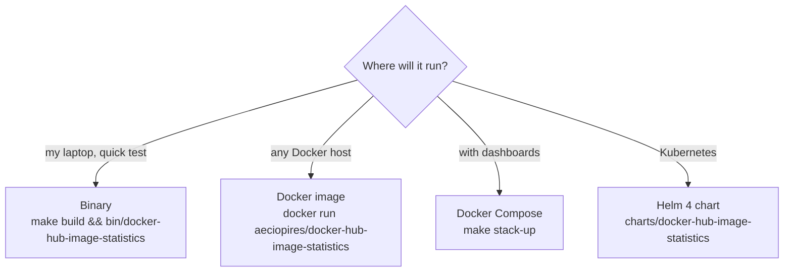
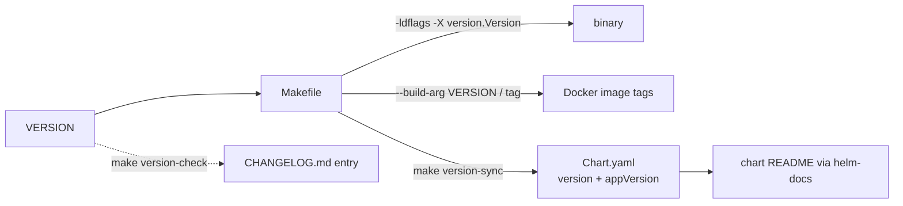

# Deployment

<!-- TOC -->
- [Options at a glance](#options-at-a-glance)
- [Binary](#binary)
- [Docker image](#docker-image)
  - [Image security](#image-security)
- [Docker Compose](#docker-compose)
- [Kubernetes with Helm 4](#kubernetes-with-helm-4)
- [Versioning and releases](#versioning-and-releases)
<!-- TOC -->

## Options at a glance



## Binary

```bash
make build                        # bin/docker-hub-image-statistics for this machine
make build-all                    # dist/: linux and darwin, amd64 and arm64 + SHA256SUMS
cp config.example.yaml config.yaml
bin/docker-hub-image-statistics   # same as: ... serve --config config.yaml
bin/docker-hub-image-statistics -h                    # every command and flag
bin/docker-hub-image-statistics -n myorg -i 30m -l debug  # flags override file and env
```

Commands: `serve` (default), `config`, `healthcheck [-u URL]`, `version`,
`completion`, `help`; global `-h/--help` and `-v/--version`. See
[configuration.md](configuration.md#command-line).

## Docker image

```bash
docker run -d --name dhis -p 8080:8080 \
  --read-only --cap-drop ALL --security-opt no-new-privileges \
  -v dhis-data:/data \
  -e DHIS_DOCKERHUB_NAMESPACES=myorg \
  aeciopires/docker-hub-image-statistics:latest
```

The history lives in the `/data` volume (SQLite + JSON). Without a volume it is
lost when the container is removed.

Build and publish (multi-arch `linux/amd64` + `linux/arm64`, with SBOM and
provenance attestations):

```bash
make docker-build                         # IMAGE:VERSION and IMAGE:latest, local platform
make docker-scan                          # trivy: vulnerabilities, secrets, misconfigurations
make docker-push IMAGE=myuser/dhis        # requires docker login
```

### Image security

| Practice | How |
| --- | --- |
| Minimal attack surface | `gcr.io/distroless/static-debian13:nonroot`: no shell, no package manager |
| Non-root | `USER 65532:65532` |
| Reproducible, pinned bases | base images pinned by digest; `-trimpath`, `-buildvcs=false`, `-buildid=` |
| Static binary | `CGO_ENABLED=0` (pure-Go SQLite) |
| Small | about 26 MB |
| Read-only friendly | the only writable path is the `/data` volume |
| Built-in health check | `HEALTHCHECK` runs the binary's `healthcheck` command |
| Scanned | `make docker-scan` (trivy) fails on MEDIUM or higher |
| Minimal build context | `.dockerignore` allow-lists `go.mod`, `go.sum`, `cmd/` and `internal/` |

## Docker Compose

```bash
make up          # application only → http://localhost:8080
make down

make stack-up    # application + OTel Collector, Prometheus, Loki, Tempo, Jaeger, Grafana
make stack-down  # keep data;  make stack-clean removes the volumes
```

Edit [`deploy/compose/config/app/config.yaml`](../deploy/compose/config/app/config.yaml)
to choose the namespaces. Optional credentials:
`DHIS_DOCKERHUB_USERNAME=... DHIS_DOCKERHUB_TOKEN=... make up`.

## Kubernetes with Helm 4

The chart requires **Helm 4** and refuses to render with Helm 3.

```bash
helm upgrade --install dhis charts/docker-hub-image-statistics \
  -n dhis --create-namespace \
  --set 'config.dockerhub.namespaces={myorg}'
helm test dhis -n dhis
```

Highlights (full list in the [chart README](../charts/docker-hub-image-statistics/README.md)):

- probes on `/healthz` (startup and liveness) and `/readyz` (readiness);
- *restricted* Pod Security Standard defaults, NetworkPolicy, no service account
  token, `Recreate` strategy with a `ReadWriteOnce` volume;
- Ingress, Gateway API `HTTPRoute` and **`extraObjects`** for any other manifest;
- `ServiceMonitor` and Grafana dashboard ConfigMaps;
- `values.schema.json` validation.

Local cluster for tests (kind + Helm 4, namespace with the *restricted* Pod
Security Standard enforced, values in [`deploy/kind/values.yaml`](../deploy/kind/values.yaml)):

```bash
make kind-up            # kind-create + kind-load (docker-build) + helm-install
make helm-reload        # after editing deploy/kind/values.yaml
make helm-status
make helm-test          # helm test (healthcheck against /readyz)
make kind-port-forward  # http://localhost:8080
make helm-uninstall     # keeps the data PVC
make kind-delete
```

## Versioning and releases

The repository root [`VERSION`](../VERSION) file is the single source of truth
([Semantic Versioning](https://semver.org)):



Release steps are in [CONTRIBUTING.md](../CONTRIBUTING.md#releasing).
