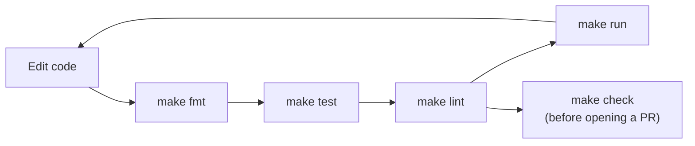

# Development guide

A guided tour for programmers who are new to Go or to this code base.

<!-- TOC -->
- [Setting up](#setting-up)
- [Daily workflow](#daily-workflow)
- [Reading the code: a suggested path](#reading-the-code-a-suggested-path)
- [Go concepts used here](#go-concepts-used-here)
- [Tests](#tests)
- [Make targets](#make-targets)
- [Changing the UI](#changing-the-ui)
- [Changing the dashboards](#changing-the-dashboards)
<!-- TOC -->

## Setting up

```bash
make install-deps   # system packages + mise + toolchain from .mise.toml
make check-deps     # verify everything
```

Details per operating system are in [REQUIREMENTS.md](../REQUIREMENTS.md).

## Daily workflow



`make run` starts the app on <http://localhost:8080> using `./config.yaml` when
it exists (copy [`config.example.yaml`](../config.example.yaml)).

## Reading the code: a suggested path

1. [`cmd/docker-hub-image-statistics/main.go`](../cmd/docker-hub-image-statistics/main.go):
   only turns OS signals into a `context` and calls `app.Main`.
2. [`internal/app/app.go`](../internal/app/app.go): the "assembly line" — it
   creates every component in order and connects them.
3. [`internal/stats/stats.go`](../internal/stats/stats.go): the heart of the
   math (windows and hourly series). Pure functions, easy to test.
4. [`internal/collector/collector.go`](../internal/collector/collector.go):
   discovery and the schedule loop.
5. [`internal/dockerhub/client.go`](../internal/dockerhub/client.go): HTTP,
   pagination, retries and rate limiting.
6. [`internal/store`](../internal/store): the `Store` interface and its tiers.
7. [`internal/server/server.go`](../internal/server/server.go): routes and middlewares.

## Go concepts used here

| Concept | Where | In one sentence |
| --- | --- | --- |
| Interfaces | `store.Store`, `collector.Source` | "Anything that has these methods" — lets tests use fakes instead of Docker Hub or SQLite |
| `context.Context` | everywhere | A cancel button passed down the call chain (shutdown, timeouts) |
| Goroutines + `sync.WaitGroup.Go` | `collector.discover` | Fetch several namespaces at the same time and wait for all |
| `atomic.Pointer` | `collector.Service` | Swap the computed statistics at once, without locks for readers |
| `go:embed` | `internal/web` | Put the UI files inside the binary at compile time |
| `encoding/json/v2` | API, client, disk store | The modern JSON package (Go 1.27) with stricter defaults |
| `log/slog` | `internal/logging` | Structured (JSON) logs with levels |
| Cobra commands | `internal/app/cli.go` | Each command (`serve`, `config`, ...) is a `cobra.Command`; flags come from `pflag` (POSIX `-c`/`--config`) |
| Viper | `internal/config/loader.go` | Merges defaults, YAML, `DHIS_*` and flags; `UnmarshalExact` rejects unknown keys |
| Method-aware `ServeMux` | `internal/server` | `GET /api/v1/images/{namespace}/{name}` + `r.PathValue("name")` |

The code follows the [Modern Go Guidelines](https://github.com/JetBrains/go-modern-guidelines)
for Go 1.27 (see [CLAUDE.md](../CLAUDE.md)).

## Tests

```bash
make test         # unit tests
make test-race    # with the race detector
make coverage     # fails below 90% (COVERAGE_MIN)
```

- Tests live next to the code (`*_test.go`) and use only the standard library
  plus Prometheus' `testutil`.
- Network calls are tested with `net/http/httptest` servers; time-dependent code
  receives injectable `Now`/`Sleep` functions, so tests never wait for real time.
- `internal/app` has an end-to-end test that starts the whole application
  against a fake Docker Hub on a random port.
- `internal/web` checks that the UI references no external URL.

## Make targets

Run `make help` for the full list. The most used:

| Target | What it does |
| --- | --- |
| `make build` / `make build-all` | Binary for this machine / release binaries |
| `make run` / `make reload` | Run locally / reload its configuration (SIGHUP) |
| `make test` / `make coverage` | Tests / tests with the 90% gate |
| `make lint` / `make vuln` | golangci-lint / govulncheck |
| `make docker-build` / `make docker-scan` / `make docker-push` | Image lifecycle |
| `make up` / `make down` / `make compose-reload` | Application with docker compose / reload its configuration |
| `make stack-up` / `make stack-down` | Application + observability stack |
| `make kind-up` / `make kind-delete` | kind cluster + image + chart / delete the cluster |
| `make helm-install` / `make helm-reload` / `make helm-test` / `make helm-uninstall` / `make helm-status` | Chart lifecycle on kind (values: `deploy/kind/values.yaml`) |
| `make kind-port-forward` / `make kind-logs` | Reach the app / follow its logs on kind |
| `make helm-validate` / `make helm-docs` | Chart checks / chart README |
| `make docs-validate` | Render every Mermaid diagram with mermaid-cli |
| `make check` | Every quality gate (what CI should run) |

## Changing the UI

The UI is plain HTML/CSS/JavaScript in
[`internal/web/static`](../internal/web/static); no build step is needed.

- Colors, type scale and shapes are Material Design 3 tokens (CSS custom
  properties such as `--md-sys-color-primary`) defined for dark (default) and
  light themes in `app.css`.
- Never load files from the Internet: copy them into `static/` (the
  `TestNoExternalResources` test and the CSP header will catch mistakes).
- Render values with `textContent`, never `innerHTML`.

## Changing the dashboards

Edit [`scripts/gen-dashboards.py`](../scripts/gen-dashboards.py) and run
`make dashboards`. The generated JSON is used by both compose (mounted into
Grafana) and the Helm chart.
