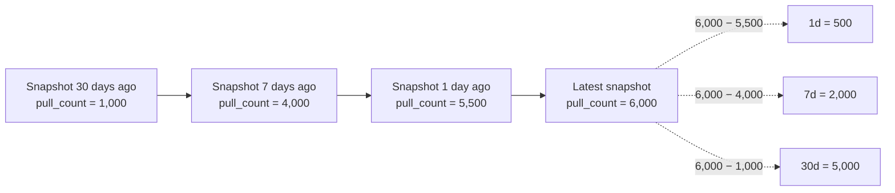
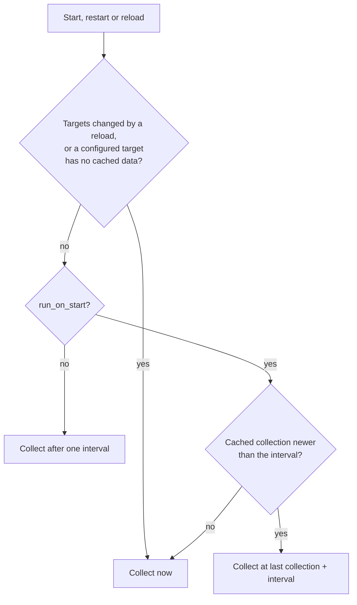
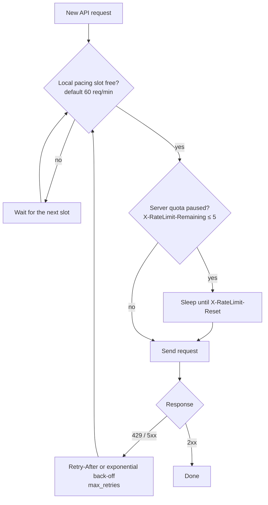
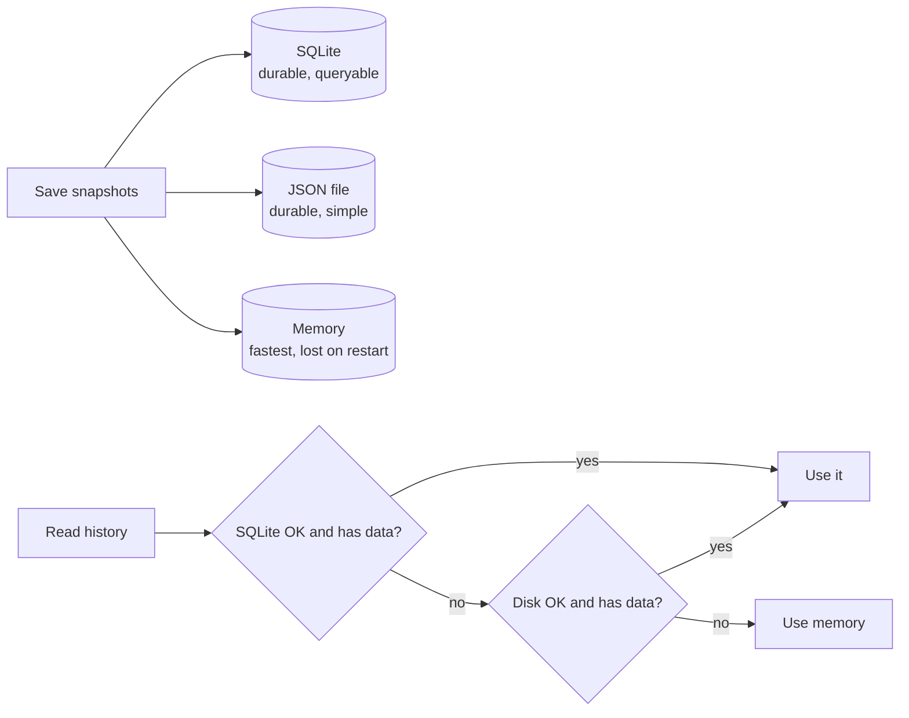

# Features

What the application does and how each feature works under the hood.

<!-- TOC -->
- [Image discovery](#image-discovery)
- [Pull statistics: total, 1d, 7d, 30d](#pull-statistics-total-1d-7d-30d)
- [Pulls in the last collection](#pulls-in-the-last-collection)
- [Hourly statistics](#hourly-statistics)
- [Collection schedule: last and next update](#collection-schedule-last-and-next-update)
- [Configuration reload](#configuration-reload)
- [Docker Hub rate limits](#docker-hub-rate-limits)
- [Cache tiers](#cache-tiers)
- [Web interface](#web-interface)
- [Health checks](#health-checks)
- [Logs, metrics and traces](#logs-metrics-and-traces)
<!-- TOC -->

## Image discovery

You tell the application *where* to look, and it finds the public images:

| Setting | Example | Meaning |
| --- | --- | --- |
| `dockerhub.namespaces` | `[grafana, library]` | Every **public** image of these users/organizations |
| `dockerhub.repositories` | `[nginx, prom/prometheus]` | Specific images (`name` alone means an official `library/` image) |
| `dockerhub.include` | `["grafana/loki*"]` | Keep only images matching at least one glob |
| `dockerhub.exclude` | `["*/*-dev"]` | Drop images matching any glob |

Globs use Go's [`path.Match`](https://pkg.go.dev/path#Match) syntax on
`namespace/name`. Private repositories are always ignored.

> **Anonymous limit.** Docker Hub only lists the first 100 repositories of a
> namespace to anonymous clients. The application requests them ordered by pull
> count, so you always get the 100 most pulled ones, and shows a warning. Set
> `dockerhub.username` and `dockerhub.token` to discover all of them.

## Pull statistics: total, 1d, 7d, 30d

Think of a car odometer: it only shows the total distance. To know how far you
drove this week, you subtract the reading from a week ago.

Rules implemented in `internal/stats`:

- The baseline of a window is the **newest snapshot taken at or before** the
  window start.
- If the history is shorter than the window, the oldest snapshot is used and the
  value is flagged `complete: false` (shown with `*` in the UI): it is a lower
  bound.
- Counters never go down; if Docker Hub ever reports a smaller number (for
  example a repository deleted and recreated) the result is clamped to zero.

## Pulls in the last collection

The difference between the two newest snapshots of an image: how many pulls
happened between the previous collection and the latest one (one collection
interval, 1 hour by default). It is the freshest number available.

- UI: **Last collection** card and sortable table column; the tooltip and the
  detail panel show the period it covers.
- API: `last_collection: {pulls, previous_at}` per image, `pulls_last_collection`
  in the summary, `?sort=last`.
- Metrics: `dockerhub_image_pulls_last_collection{namespace,repository}`.
- Grafana: stat, table column, top 10 and a bar chart per image.

It is `0` for the first collection of an image (nothing to compare with yet).

## Hourly statistics

`GET /api/v1/images/{namespace}/{name}/history?range=24h&step=1h` turns the
snapshots into buckets of one hour (the step is configurable). Each point has:

- `pulls_total`: the counter at that hour;
- `pulls`: how much it grew since the previous hour.

The UI shows them as a bar chart and a table (24 hours, 7 days or 30 days). The
Grafana dashboard shows the same information from Prometheus with
`increase(dockerhub_image_pulls_total[1h])`.

## Collection schedule: last and next update

The collector runs once at startup (`collector.run_on_start`) and then every
`collector.interval` (default **1h**). The UI header shows:

- **Last update**: time of the newest stored collection (restored from the cache
  after a restart);
- **Next update**: when the next collection is due, with a live countdown;
- **Interval**: the configured interval.

The same values are available in `/api/v1/status` and as the metrics
`dhis_last_collection_success_timestamp_seconds` and
`dhis_next_collection_timestamp_seconds`.

Restarts, rollouts and configuration reloads **keep the schedule**: when the
cache holds a collection newer than the interval, the next collection happens
at *last collection + interval* instead of immediately. This saves Docker Hub
API calls and keeps snapshots evenly spaced (otherwise the "last collection"
pulls would cover only a few seconds). Exception: when a configured namespace or
repository has no cached data yet (it was just added), the application collects
immediately so it shows up.

## Configuration reload

Send `SIGHUP` (`make reload`, `make compose-reload`) to reload the YAML file and
the environment without exiting; invalid configurations are rejected and the
current one keeps running. On Kubernetes `make helm-reload` rolls the pod. See
[configuration.md](configuration.md#reloading-the-configuration).

## Docker Hub rate limits

Docker Hub limits API calls per source IP. For anonymous clients the response
headers currently say `X-RateLimit-Limit: 180` per 60-second window. The client
respects the limits in four layers:

1. **Pacing**: `dockerhub.requests_per_minute` (0 = automatic: 60 anonymous,
   150 authenticated). Anonymous configurations above 180 are rejected.
2. **Quota awareness**: when `X-RateLimit-Remaining` drops to 5 or less, the
   client waits until `X-RateLimit-Reset`.
3. **Retries**: `429` and `5xx` responses are retried honoring `Retry-After`.
4. **Minimum interval**: `collector.interval` must be at least 5 minutes without
   credentials (1 minute with credentials).

## Cache tiers

Metrics are cached in **SQLite, disk and memory, in this order**.

Analogy: an original document in a safe (SQLite), a photocopy in a drawer
(disk) and a note on your desk (memory). You update all three; to read, you
use the original unless it is unavailable.

- Writes fail only when **every** tier fails; a broken tier is logged and counted
  in `dhis_cache_operations_total{result="error"}`.
- On startup, empty tiers are *warmed* with the history of the first tier that
  has data.
- `cache.retention` (default 90 days) controls how long snapshots are kept.
- Any tier can be disabled; at least one must stay enabled.

## Web interface

- Material Design 3 color, typography and components, **dark mode by default**
  with a light/dark selector (remembered per browser).
- Summary cards (total, 24h, 7d, 30d, images, stars), searchable and sortable
  table, per-image hourly chart and table, link to the Docker Hub page.
- Completely self-contained: HTML, CSS, JavaScript, the Roboto font (OFL-1.1),
  icons and favicon are embedded in the binary. Nothing is downloaded from the
  Internet, which a strict Content-Security-Policy enforces.

## Health checks

| Endpoint | Used by | Meaning |
| --- | --- | --- |
| `GET /healthz` (alias `/livez`) | liveness probe, Docker `HEALTHCHECK` | The process is up and serving HTTP |
| `GET /readyz` | readiness probe, `helm test` | At least one cache tier is usable |

The image has no shell or `curl`, so the binary has a `healthcheck` command:
`docker-hub-image-statistics healthcheck [-u|--url http://127.0.0.1:8080/healthz]`.

## Logs, metrics and traces

- **Logs**: JSON on stdout with `level` (default `INFO`), `trace_id` and
  `span_id`; optionally exported over OTLP to Loki.
- **Metrics**: Prometheus format on `/metrics` (per image and per process).
- **Traces**: OpenTelemetry spans for HTTP requests, collections and Docker Hub
  calls, exported over OTLP to Tempo and Jaeger.

See [observability.md](observability.md) for the full list and the dashboards.
