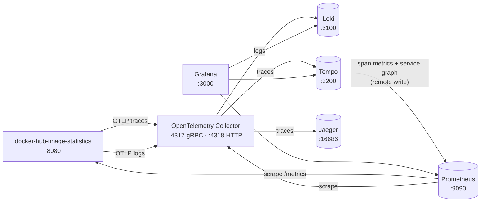

# Observability

The three classic signals — **metrics**, **logs** and **traces** — are
available, plus a ready-to-run stack and Grafana dashboards.

<!-- TOC -->
- [The three signals, by analogy](#the-three-signals-by-analogy)
- [Local stack](#local-stack)
- [Metrics](#metrics)
  - [Image metrics](#image-metrics)
  - [Application metrics](#application-metrics)
  - [Useful PromQL](#useful-promql)
- [Logs](#logs)
- [Traces](#traces)
- [Grafana dashboards](#grafana-dashboards)
- [Known limitation: Jaeger data source](#known-limitation-jaeger-data-source)
<!-- TOC -->

## The three signals, by analogy

Imagine a delivery company:

- **Metrics** are the dashboard of the truck: speed, fuel, kilometers. Numbers
  over time, cheap to store, great for alerts.
- **Logs** are the driver's diary: "08:02 delivered package 42 to Main St.".
  Detailed text events.
- **Traces** are the GPS route of one package: every stop it made, and how long
  each stop took.

The `trace_id` written in every log line links the diary entry to the GPS
route, so Grafana can jump from a log line to its trace and back.

## Local stack

`make stack-up` starts the application and the newest versions of every
backend, already connected:



| Service | URL | Version |
| --- | --- | --- |
| Application | <http://localhost:8080> | this repository |
| Grafana | <http://localhost:3000> (`admin`/`admin`, anonymous viewer enabled) | 13.3.1 |
| Prometheus | <http://localhost:9090> | 3.16.0 |
| Jaeger UI | <http://localhost:16686> | 2.23.0 |
| Loki | <http://localhost:3100> | 3.7.10 |
| Tempo | <http://localhost:3200> | 3.1.1 |
| OpenTelemetry Collector (contrib) | `localhost:4317`, `localhost:4318` | 0.165.0 |

Every port is bound to `127.0.0.1` only. Change the Grafana password with
`GRAFANA_ADMIN_PASSWORD=... make stack-up`. Configuration lives in
[`deploy/compose/config`](../deploy/compose/config).

## Metrics

Exposed on `GET /metrics` (Prometheus text or OpenMetrics).

### Image metrics

Labels: `namespace`, `repository` (and `window` where noted).

| Metric | Type | Description |
| --- | --- | --- |
| `dockerhub_image_pulls_total` | counter | Total pulls reported by Docker Hub |
| `dockerhub_image_pulls{window="1d\|7d\|30d"}` | gauge | Pulls inside the window |
| `dockerhub_image_pulls_window_complete{window}` | gauge | `1` when history covers the window |
| `dockerhub_image_pulls_last_collection` | gauge | Pulls between the two newest collections |
| `dockerhub_image_stars` | gauge | Stars |
| `dockerhub_image_last_updated_timestamp_seconds` | gauge | Last push to the repository |
| `dockerhub_image_collected_timestamp_seconds` | gauge | Newest snapshot of the image |
| `dockerhub_images` | gauge | Number of tracked images |

### Application metrics

| Metric | Type | Description |
| --- | --- | --- |
| `dhis_collections_total{result}` | counter | Collections by `success`/`error` |
| `dhis_collection_duration_seconds` | histogram | Collection duration |
| `dhis_last_collection_duration_seconds` | gauge | Duration of the last collection |
| `dhis_last_collection_images` | gauge | Images collected in the last cycle |
| `dhis_last_collection_success_timestamp_seconds` | gauge | Last successful collection (Unix time) |
| `dhis_next_collection_timestamp_seconds` | gauge | Next scheduled collection (Unix time) |
| `dhis_collection_in_progress` | gauge | `1` while collecting |
| `dhis_cache_operations_total{tier,op,result}` | counter | Cache tier operations |
| `dhis_http_requests_total{method,route,code}` | counter | HTTP requests |
| `dhis_http_request_duration_seconds{method,route}` | histogram | HTTP latency |
| `dhis_build_info{version,commit,go_version}` | gauge | Always `1` |
| `go_*`, `process_*` | various | Go runtime and process metrics |

### Useful PromQL

```promql
# Pulls per hour of each image
sum by (namespace, repository) (increase(dockerhub_image_pulls_total[1h]))

# Top 10 images of the last 7 days
topk(10, dockerhub_image_pulls{window="7d"})

# Pulls observed in the newest collection, all images
sum(dockerhub_image_pulls_last_collection)

# Alert: no successful collection for 3 hours
time() - dhis_last_collection_success_timestamp_seconds > 3 * 3600
```

## Logs

- Always written to **stdout as JSON**, one object per line, with `time`,
  `level`, `msg`, `service`, `version` and context fields.
- Level from `log.level` / `DHIS_LOG_LEVEL` (default **`INFO`**). Health checks,
  scrapes and static files are logged at `DEBUG` to keep logs quiet.
- Inside a traced request every record carries `trace_id` and `span_id`.
- With `telemetry.logs=true` the same records are exported over OTLP; Loki 3
  stores them with `service_name` as a label and the attributes as structured
  metadata.

```json
{"time":"2026-11-17T11:00:42Z","level":"INFO","msg":"collection finished","service":"docker-hub-image-statistics","version":"1.0.0","images":101,"duration":"2.17s","errors":false}
```

## Traces

With `telemetry.traces=true` the application creates spans for:

- every HTTP request (`GET /api/v1/images`, ...; probes are excluded);
- every collection (`collector.collect`, `collector.discover`, `collector.reload`);
- every Docker Hub API call (HTTP client spans, so you can see retries and waits).

The W3C `traceparent` header is honored, so traces continue across services.

## Grafana dashboards

Generated by [`scripts/gen-dashboards.py`](../scripts/gen-dashboards.py) into
[`charts/docker-hub-image-statistics/dashboards`](../charts/docker-hub-image-statistics/dashboards)
(used by compose and by the Helm chart):

| Dashboard | Content |
| --- | --- |
| **Docker Hub Image Statistics** | Total/last collection/1d/7d/30d pulls, images, stars, last/next update, pulls per hour by image, pulls in the last collection by image, cumulative pulls, top 10 per window and per last collection, per-image table; filters by namespace and repository |
| **Docker Hub Image Statistics — Service** | Up, collections OK/error, last/next update, collection duration, cache operations, HTTP rate/latency, memory/CPU, Tempo span metrics, recent traces, log volume by level and application logs |

Both use data source variables, so they also work in an existing Grafana
(`grafanaDashboards.enabled=true` in the Helm chart).

## Known limitation: Jaeger data source

Jaeger v2.23 removed the legacy HTTP API (`/api/services`, `/api/traces`) that
the Grafana 13 Jaeger data source still calls. The collector therefore sends
traces to **both** Tempo and Jaeger: use Tempo inside Grafana (with logs ↔
traces ↔ metrics correlation) and the Jaeger UI at <http://localhost:16686> (a
link is available on both dashboards).
