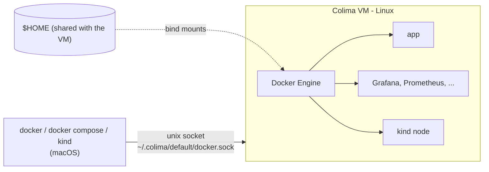

# macOS-specific requirements

Only what differs on macOS (Intel `amd64` and Apple silicon `arm64`). Everything
else is in [REQUIREMENTS.md](../../REQUIREMENTS.md).

<!-- TOC -->
- [Xcode Command Line Tools](#xcode-command-line-tools)
- [Homebrew](#homebrew)
- [Docker with Colima](#docker-with-colima)
  - [Install](#install)
  - [Enable the Compose and Buildx plugins](#enable-the-compose-and-buildx-plugins)
  - [Start and stop](#start-and-stop)
  - [Shared directories](#shared-directories)
  - [kind on Colima](#kind-on-colima)
- [Apple silicon notes](#apple-silicon-notes)
- [Shell and make notes](#shell-and-make-notes)
<!-- TOC -->

## Xcode Command Line Tools

Provide `git`, `make` and `python3`. `make install-deps` checks them and starts
the installer when missing:

```bash
xcode-select --install
```

## Homebrew

[Homebrew](https://brew.sh) installs Colima and the Docker CLI. When it is
present, `make install-deps` also installs mise with `brew install mise`
(otherwise it uses the official `https://mise.run` installer). Activate mise in
zsh:

```bash
echo 'eval "$(mise activate zsh)"' >> ~/.zshrc
```

## Docker with Colima

On macOS this project uses [Colima](https://github.com/abiosoft/colima): a
lightweight Linux VM that runs the Docker Engine, used through the regular
`docker` CLI. Analogy: Docker needs a Linux kitchen to cook containers; macOS
does not have one, so Colima rents a small Linux kitchen next door and the
`docker` command is the waiter that carries the orders there.



### Install

```bash
brew install colima docker docker-compose docker-buildx
```

### Enable the Compose and Buildx plugins

Homebrew installs `docker-compose` and `docker-buildx` as standalone binaries;
tell the Docker CLI where they are so `docker compose` and `docker buildx` work
(the Makefile uses these forms):

```bash
mkdir -p ~/.docker
cat > ~/.docker/config.json <<'JSON'
{
  "cliPluginsExtraDirs": ["/opt/homebrew/lib/docker/cli-plugins", "/usr/local/lib/docker/cli-plugins"]
}
JSON
docker compose version && docker buildx version
```

`/opt/homebrew` is the Homebrew prefix on Apple silicon and `/usr/local` on
Intel; keeping both is harmless. Merge the key into an existing
`config.json` instead of overwriting it.

### Start and stop

The observability stack and kind need at least 2 CPUs and 4 GB of memory:

```bash
make colima-start   # colima start --cpu 4 --memory 8 --disk 60 (COLIMA_CPU/COLIMA_MEMORY/COLIMA_DISK)
make colima-status
make colima-stop
```

Colima creates and selects the `colima` Docker context, so no `DOCKER_HOST` is
needed. If another context is active: `docker context use colima`.
`make check-deps` reports whether Colima is running.

To start it at login: `brew services start colima`.

### Shared directories

Bind mounts only work for directories shared with the VM, by default your home
directory. Clone the repository under `$HOME` (for example `~/git/...`). The
project scripts keep their temporary files inside the repository for the same
reason (macOS `mktemp` uses `/var/folders`, which the VM cannot see).

### kind on Colima

kind runs its Kubernetes node as a container inside the Colima VM, so
`make kind-up` works unchanged. Give Colima enough memory (`make colima-start`
defaults to 8 GB) before creating the cluster.

## Apple silicon notes

- Colima uses the native `aarch64` VM; the image is published for `linux/amd64`
  and `linux/arm64`, so it runs natively. `make build-all` produces
  `darwin_arm64` and `darwin_amd64` binaries.
- `make docker-push` builds both platforms with Buildx. Go cross-compiles inside
  the builder stage, so QEMU emulation is not required.

## Shell and make notes

- macOS ships bash 3.2 and GNU make 3.81; the scripts and the Makefile are
  written to work with both (no GNU-only `sed -i`, no make 4 features).
- `sha256sum` is replaced by `shasum -a 256` automatically in `make build-all`.
